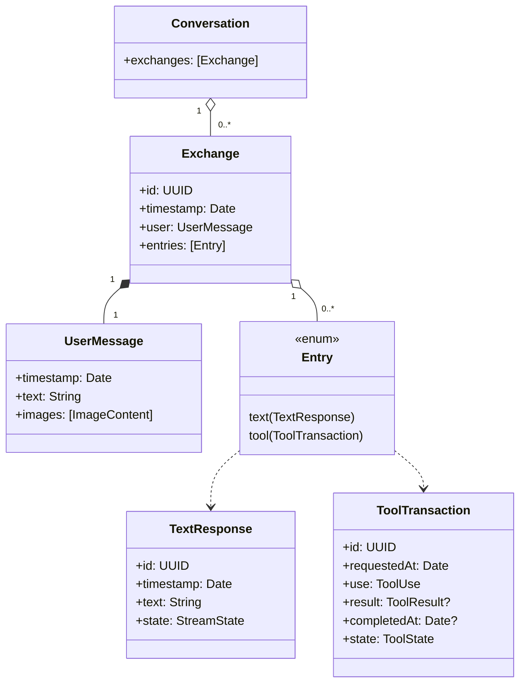

# RFC 0001 — Conversation Structure

- **Status:** Draft
- **Author:** @schwa
- **Created:** 2026-06-26
- **Affects:** `CollaborationKit/Core` (new canonical conversation model)

## Summary

Define a nested conversation structure as the **canonical** in-memory model: the
single source of truth the session owns, mutates as events arrive, and the UI
renders directly. It groups one user turn with everything the assistant does in
response, pairs each tool request with its result, and timestamps every record
independently.

## Motivation

A flat list of messages with ordered content blocks matches the provider wire
formats, but it is the wrong shape to *own*:

- We want "one user message + everything the assistant did in response" grouped
  as a single unit.
- We want each tool call to be one record with a clear lifecycle
  (pending → done/error), not two entries correlated by id.
- We want to distinguish a *streaming* text response (live, mutating) from a
  *complete* one — as a **state**, not a separate type.
- We want every record to carry its own accurate timestamp.

This RFC makes the nested structure the real data model. Wire formats are an
encoding concern at the provider boundary, not the shape we hold onto.

## Design

### Shape

```
Conversation
  Exchange (0+)              — one user turn + the assistant's full reply
    UserMessage             — text + optional images
    Entry (0+)              — ordered; text and tool transactions interleave
      • TextResponse        { text, state: streaming | complete }
      • ToolTransaction     { request, result?, state: pending | done | error }
```



### Principles

- **Exchange** is the top-level group: a user message and every assistant entry
  produced until control returns to the user.
- **An Entry is *not* a "Response."** A `TextResponse` is what the assistant
  *says* — a reply. A `ToolTransaction` is a side-effect the assistant
  *triggers*, not a reply. They are distinct kinds of `Entry` and must not be
  conflated. A `ToolTransaction`'s *result* is a separate, later-timestamped
  fact.
- **Entries interleave.** Not "text OR tools" — the assistant may emit text,
  call a tool, emit more text, call another tool. The ordered list preserves
  this.
- **Streaming is a state, not a type.** A live response is the *same node*
  transitioning `streaming → complete`. Same for tools: `pending → done/error`.
  Node identity never churns mid-stream.
- **Everything is timestamped.** Every record carries its own timestamp, set
  when that fact occurs and never back-filled or shared: the `Exchange`, the
  `UserMessage`, each `TextResponse`, and — independently — the tool *request*
  and the tool *result* inside a `ToolTransaction`.

### Swift types (sketch — open for discussion)

```swift
public struct Conversation {
    public var exchanges: [Exchange]
}

public struct Exchange: Identifiable {
    public let id: UUID
    public let timestamp: Date         // when the exchange began
    public var user: UserMessage
    public var entries: [Entry]
}

public struct UserMessage {
    public let timestamp: Date
    public var text: String
    public var images: [ImageContent]
}

public enum Entry: Identifiable {
    case text(TextResponse)
    case tool(ToolTransaction)
    public var id: UUID { ... }
}

public struct TextResponse: Identifiable {
    public let id: UUID
    public let timestamp: Date          // when this text began
    public var text: String
    public var state: StreamState       // .streaming | .complete
}

public struct ToolTransaction: Identifiable {
    public let id: UUID                 // stable for the call's lifetime
    public let requestedAt: Date        // when the model requested the call
    public var use: ToolUse
    public var result: ToolResult?
    public var completedAt: Date?       // when the result arrived (nil if pending)
    public var state: ToolState         // .pending | .done | .error
}
```

The tool request and its result are timestamped independently
(`requestedAt` vs `completedAt`); a pending transaction has no `completedAt`.

### How it is built and updated

The session owns the `Conversation` and mutates it as a turn progresses:

- A user turn appends a new `Exchange` (with its `UserMessage`).
- Assistant text begins a `TextResponse` (`.streaming`); deltas append to it;
  completion flips it to `.complete`.
- A tool request appends a `.pending` `ToolTransaction` and stamps
  `requestedAt`; its result fills in `result`/`completedAt` and flips state to
  `.done`/`.error`.

Each mutation is timestamped at the moment it happens, satisfying the
per-record timestamp requirement directly.

## Open Questions

1. **Identity/keying.** How are `Entry` / `ToolTransaction` ids generated so
   they stay stable across mutations for SwiftUI diffing?
2. **Mutability.** Is `Conversation` a value type the session replaces on each
   change, or an observable reference the UI binds to?
3. **Edge cases.** Exchange with zero entries? Tool error rendering? User
   message with images but no text?
4. **Compaction** *(not implemented yet)*. When old exchanges are summarized to
   reclaim context-window tokens, how is the compacted region represented? A
   summary `Entry`/`Exchange` that stands in for a collapsed range? Are the
   original records kept (for display/replay) while a separate summary is what
   gets sent to the provider? How does this interact with timestamps and
   identity?
5. **Turn-level / provider errors.** Distinct from tool errors (already modeled
   by `ToolResult.isError` / `ToolTransaction.state == .error`): a request that
   fails, a model that errors mid-stream, a dropped connection. Where does this
   live — a new `Entry` case, an `Exchange`-level error field, or both? Can a
   partially-streamed `TextResponse` be marked failed rather than just
   incomplete?
6. **Status messages.** Ephemeral, non-content notices (“thinking…”,
   “retrying”, “rate-limited, waiting”, “compacting…”). Are these part of the
   persisted structure or a transient side-channel the UI consumes separately?
   If persisted, do they belong to an `Exchange`, or float at the conversation
   level?

## Non-Goals

- Defining SwiftUI views — this RFC is about the data structure they consume.

## Alternatives Considered

- **Holding a flat list of messages with content blocks.** Rejected as the
  canonical model: forces consumers to re-group and re-derive streaming state,
  and to correlate tool results to calls by id.
- **Separate types for streaming vs complete text.** Rejected: causes node
  identity churn mid-stream and complicates diffing.
- **Calling tool transactions "responses."** Rejected: a tool transaction is a
  side-effect the assistant triggers, not a reply. Hence the neutral `Entry`
  umbrella.
